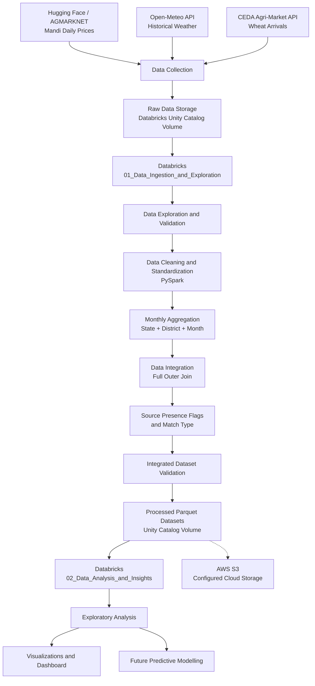

# Mandi Price Intelligence – Project Architecture

## 1. Architecture Overview

Mandi Price Intelligence follows a Big Data engineering pipeline that collects agricultural mandi prices, wheat arrivals, and historical weather information from multiple external sources.

The datasets are loaded into Databricks, processed using Apache Spark (PySpark), cleaned, standardized, aggregated, and integrated into a unified monthly dataset.

The processed datasets are stored in a Databricks Unity Catalog Volume in Parquet format. AWS S3 is configured as the project's cloud object storage.

The pipeline supports agricultural market analysis and provides a foundation for future dashboard development and predictive modelling.

## 2. Architecture Diagram



## 3. External Data Sources

The project integrates three primary datasets:

1. **Mandi Daily Prices:** Historical agricultural market prices obtained from a Hugging Face dataset sourced from AGMARKNET.
2. **Weather Data:** Historical weather observations collected using the Open-Meteo Historical Weather API for five districts in Tamil Nadu.
3. **Wheat Arrivals:** Monthly wheat arrival quantities obtained through the CEDA Agri-Market API.

The datasets have different geographical and temporal coverage, which is considered during integration.

## 4. Data Collection Layer

Data is collected from the external sources using dataset downloads and API-based extraction.

The collected datasets include:

| Dataset | Raw Records | Coverage |
|---|---:|---|
| Mandi Daily Prices | 5,827,604 | January–December 2025 |
| Wheat Arrivals | 2,370 | January–October 2025 |
| Historical Weather | 1,825 | January–December 2025 |

The raw datasets are loaded into the Databricks processing environment for further processing.

## 5. Raw Data Storage Layer

Raw datasets are maintained in a Databricks Unity Catalog Volume.

**Volume path:**

`/Volumes/workspace/default/mandi_project_data/`

The storage area maintains the original datasets used by the processing notebooks.

AWS S3 is also configured for cloud object storage.

**AWS S3 bucket:**

`mandi-price-intelligence-2026-584310482678-ap-south-1-an`

**Region:** `ap-south-1` (Asia Pacific – Mumbai)

## 6. Data Processing and Integration Layer

Data processing is performed using **Databricks and Apache Spark (PySpark)**.

The main processing operations include:

- Loading raw Parquet, JSON, and CSV datasets.
- Exploring schemas, record counts, and data coverage.
- Checking missing values and duplicate records.
- Standardizing State, District, and Commodity names.
- Filtering mandi records for Wheat.
- Aggregating mandi prices by State, District, and Month.
- Aggregating wheat arrivals by State, District, and Month.
- Aggregating weather observations by State, District, and Month.
- Integrating the aggregated datasets using a full outer join.
- Creating source-presence indicators and a `Match_Type` column.
- Validating the integrated dataset.

The integration uses the following common keys:

`State`, `District`, and `Month`.

The full outer join preserves available records from all three datasets.

## 7. Processed Data Storage Layer

The processed datasets are saved in Parquet format in the Databricks Unity Catalog Volume.

**Processed data path:**

`/Volumes/workspace/default/mandi_project_data/processed/`

The four primary outputs are:

| Dataset | Records | Description |
|---|---:|---|
| `monthly_mandi_prices` | 2,995 | Monthly wheat price statistics |
| `monthly_wheat_arrivals` | 2,370 | Monthly wheat arrival quantities |
| `monthly_weather` | 60 | Monthly district-level weather statistics |
| `monthly_combined_intelligence` | 3,798 | Integrated dataset containing available source records |

Parquet is used as a columnar storage format suitable for analytical processing.

## 8. Data Integration Results

The combined dataset contains 3,798 records.

| Match Type | Records |
|---|---:|
| Mandi + Arrivals | 1,627 |
| Mandi Only | 1,368 |
| Arrivals Only | 743 |
| Weather Only | 60 |
| All Three Sources | 0 |
| **Total** | **3,798** |

The integrated dataset contains source-presence indicators:

- `Mandi_Present`
- `Arrivals_Present`
- `Weather_Present`

It also contains `Match_Type`, which identifies the source combination contributing to each record.

Duplicate State-District-Month keys: **0**.

## 9. Cloud Storage Layer

The project uses two storage environments:

**Databricks Unity Catalog Volume**

Used to maintain the raw datasets and processed Parquet outputs used by the Databricks notebooks.

**AWS S3**

Configured as cloud object storage for the project.

The intended logical storage organization is:

```text
mandi-price-intelligence/
│
├── raw/
│   ├── Mandi price data
│   ├── Weather data
│   └── Wheat arrivals data
│
└── processed/
    ├── monthly_mandi_prices
    ├── monthly_wheat_arrivals
    ├── monthly_weather
    └── monthly_combined_intelligence
```

AWS credentials and secret access keys must not be committed to GitHub.

## 10. Downstream Usage

The processed datasets support:

- Monthly wheat price trend analysis.
- Wheat arrival pattern analysis.
- State-level and district-level price comparisons.
- District-level price volatility analysis.
- Exploratory analysis of relationships between prices and arrivals.
- Future agricultural market dashboards.
- Future predictive modelling.

Weather-based market analysis requires improved geographical matching between the weather and agricultural datasets.

## 11. Data Integration Limitations

The three datasets have different geographical coverage.

The weather dataset covers five districts in Tamil Nadu, while the available wheat arrivals data does not contain matching Tamil Nadu wheat district records.

Consequently, there are no records matching all three sources simultaneously.

The full outer join preserves the available records without forcing incorrect geographical matches.

Additional limitations include:

- Wheat arrivals data is available only from January to October 2025.
- The unit of the arrival quantity field has not been confirmed.
- Weather coverage is limited to five Tamil Nadu districts.
- Weather records do not currently match the agricultural datasets at the State-District-Month level.

## 12. Databricks Notebook Architecture

The primary processing workflow is organized into Databricks notebooks.

| Notebook | Responsibility |
|---|---|
| `01_Data_Ingestion_and_Exploration` | Data loading, exploration, cleaning, standardization, aggregation, integration, and validation |
| `02_Data_Analysis_and_Insights` | Exploratory data analysis and agricultural market insights |
| `03_Visualizations_and_Dashboard` | Planned visualization and dashboard development |

The first two notebooks form the current processing and analysis workflow.

## 13. Technology Stack

| Component | Technology |
|---|---|
| Programming Language | Python |
| Big Data Processing | Apache Spark (PySpark) |
| Development Environment | Databricks |
| Data Extraction | APIs and dataset downloads |
| Data Formats | CSV, JSON, Parquet |
| Databricks Storage | Unity Catalog Volumes |
| Cloud Object Storage | AWS S3 |
| Version Control | Git and GitHub |

## 14. Architecture Summary

The Mandi Price Intelligence architecture follows a multi-source data engineering approach.

External datasets are collected and loaded into Databricks, where PySpark performs data cleaning, standardization, aggregation, integration, and validation.

The resulting datasets are stored in a Unity Catalog Volume and used for exploratory analysis and future visualization development.

The architecture provides a foundation for building a scalable agricultural data pipeline that can be extended with additional datasets, improved geographical matching, automated processing, and predictive analytics.